<div align="center">

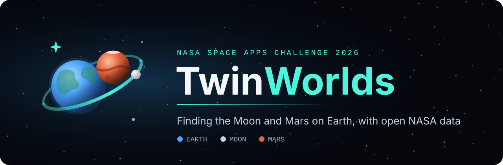

<h3>Search the whole Earth for the places that best stand in for future Moon bases and Mars landing sites,<br/>and show exactly why each one works, and where it breaks.</h3>

<p>
<a href="https://twinworld-topaz.vercel.app/"></a>


</p>

<p>


</p>

**[The challenge](#-the-challenge)** ·
**[Resources](#-challenge-resources-and-how-we-used-every-one)** ·
**[Our answer](#-our-answer-in-one-minute)** ·
**[Website tour](#-website-tour)** ·
**[Judging map](#-where-each-judging-criterion-is-met)** ·
**[Science](#-the-science-how-a-score-is-made)** ·
**[ML](#-machine-learning)** ·
**[System design](#-system-design)** ·
**[Run it](#-run-it-locally)**

</div>

---

## 🛰 The challenge

<table>
<tr>
<td width="62%">

### Identify Earth Locations that Analog the Permanent Moon Base Locations and Mars

Selecting landing sites and lunar base locations depends on topography, geology, environment and resources.
Places on Earth that resemble the Moon or Mars (the Atacama Desert, Haughton Crater, Death Valley) let mission teams
test equipment and methods before they fly, but **these terrestrial analogues are not well characterised.**

The challenge: use open Earth, Moon and Mars data from NASA and partner agencies to **identify and characterise new
terrestrial analogues** for future bases or landing sites (deserts, polar regions, volcanic and arid terrain, caves)
and present the findings as a map, visualisation or tool.

</td>
<td width="38%">

| | |
|---|---|
| **Event** | 2026 NASA Space Apps Challenge |
| **Difficulty** | Advanced · Intermediate · Beginner/Youth |
| **Subjects** | Earth Science · Planets & Moons · Software · Space Exploration |
| **Our entry** | **TwinWorlds**, a live web app |
| **Live** | [twinworld-topaz.vercel.app](https://twinworld-topaz.vercel.app/) |

</td>
</tr>
</table>

### What the challenge asks for

| # | Objective from the brief | TwinWorlds' answer |
|:-:|---|---|
| 1 | Use **open NASA Earth data** together with **Moon and Mars data** from NASA and other agencies | 33 catalogued datasets from **NASA, CSA, ESA and JAXA**; 2.48 GB of raw files processed into the site ([Data Lab](#7-data-lab-data)) |
| 2 | **Identify and characterise** Earth locations that could act as analogues for **candidate Moon-base** or **Mars landing** sites | The **Analog Finder** scores all **354,342 land cells** of Earth against **16 real targets**: 8 lunar south-pole sites (Shackleton rim, Haworth, Mons Mouton…) + the Marius Hills pit, and 7 Mars sites from Jezero to Phoenix |
| 3 | Explain **what makes a place analogous, and what does not** | Every score is broken into 7 measured dimensions; every target shows a "No Earth site can match these" panel (gravity, vacuum, radiation, chemistry) |
| 4 | **Look beyond well-known sites** | The Finder ranks *every* cell, so it surfaces unstudied places; a **Pakistan spotlight** (Hingol, Cholistan, Thar, Khewra) adds analogues that get little attention |
| 5 | Think about **processes, scale, subsurface and operations** | Lava-tube analogues (Medicine Lake, Kīlauea → Marius Hills pit), dust layers, ice/cold-trap layers, a per-site **Mission Score** for landing, rover and crew operations |
| 6 | Present as a **map, visualisation, similarity metric, ML tool or app** | All of them: 3D globes, NASA tile maps, a similarity metric, two ML models, an AI guide and five games |

### The dimensions of analogy we cover

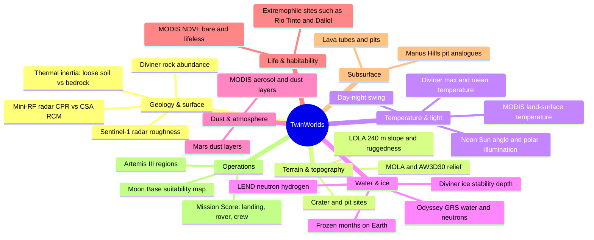

### Every "potential consideration" in the brief, answered

| Consideration from the brief | Where TwinWorlds handles it |
|---|---|
| *Think beyond visual similarity* | The Finder uses **no imagery at all**: only measured temperature, inertia, vegetation, ice, Sun angle and relief. Photos are for people, numbers are for the score. |
| *Consider different dimensions of analogy* | 7 Finder dimensions, 10 Moon Base layers, 12 Mission Score factors, each with its dataset badge. |
| *An analog does not have to match everything* | Per-dimension bars show what matches and what doesn't; Compare names the **one shared feature** and lists the **important differences** for each pair. |
| *Think about processes as well as places* | Science layers for dust, aerosols, snow, day and night temperature on Earth; dust on Mars; cold traps and ice stability on the Moon. |
| *Look beyond well-known analog sites* | Whole-Earth ranking plus a "sanity check" against 30 known sites, and the Pakistan spotlight. |
| *Explore the whole Earth, including below its surface* | Lava caves and pits (Medicine Lake, Kīlauea, Marius Hills pit), salt mines (Khewra), mud volcanoes (Hingol). |
| *Use multiple datasets when useful* | One score combines MODIS (NASA), AW3D30 (JAXA) and, on the target side, LRO Diviner/LOLA, Odyssey GRS/NS, MGS TES and MOLA. |
| *Consider scale* | 0.25° (~28 km) whole-Earth grid, then 240 m lunar south-pole maps, then site-level Sentinel-1/2 and Worldview imagery. |
| *Connect your analog to exploration* | Moon Base map with the **9 Artemis III candidate regions**, a Mission Score per site and mission type, and games about landing, roving and launch windows. |
| *Be creative with your approach* | AI robot guide that **acts on the site**, cinematic globe tours, Radar Twins, an Analogue Space ML chart. |
| *Remember Earth's limits as an analog* | Every Finder target opens with a warning panel: gravity, vacuum or thin CO₂ air, radiation and chemistry are excluded from the score and explained. |
| *Surprise us* | The Finder regularly ranks places nobody has tested above the classic sites; the [Models page](#6-models-models) shows honestly when ML does *not* beat hand-set weights. |

---

## 📚 Challenge resources, and how we used every one

The challenge lists ten resources. We used **eight directly**, catalogued one, and documented what the last one would
add (it needs an account we could not get in time).

| Agency | Resource listed in the challenge | Status | How TwinWorlds uses it | Feature |
|:-:|---|:-:|---|---|
| NASA | **Earthdata Search** | ✅ | MODIS **MOD11C3** land-surface temperature, **MOD13C2** NDVI, **MCD43C3** albedo (LP DAAC); live **CMR granule search** through our `/api/cmr/granules` route | Finder, Data Lab, Explore |
| NASA | **Worldview** | ✅ | GIBS tiles for the live Earth map; true-colour, temperature, NDVI and ASTER relief snapshots of **17 analogue sites** | Explore, Compare, Data Lab |
| NASA | **Planetary Data System (PDS)** | ✅ | LOLA DEM and slope, Diviner GDR and polar products, Mini-RF CPR, LEND neutrons, Odyssey GRS/NS, MGS TES thermal inertia, MOLA MEGDR | Finder targets, Bases, Explore layers |
| NASA | **Lunar Reconnaissance Orbiter (LRO)** | ✅ | **LOLA**, **Diviner**, **Mini-RF**, **LEND** and **LROC** (Moon Trek mosaics, CGI Moon Kit) | Bases, Explore, Compare |
| NASA | **LRO Diviner lunar data** | ✅ | Polar Resource Product (ice stability depth), max/mean temperature, rock abundance, night regolith temperature | Bases (ice and cold-trap layers), Finder Moon targets |
| CSA | **RADARSAT Constellation Mission (RCM)** | ✅ | 3 sample scenes processed into **Radar Twins**: Earth radar beside a Mini-RF lunar crater, with histograms | Compare → Radar Twins |
| CSA | **SAR Python tutorial** | ✅ | Our `scripts/build-radar-twins.py` follows its read → inspect → geolocate → plot steps | Radar Twins |
| CSA | **RADARSAT-1 archive** | 🔒 | Catalogued in the Data Lab with what it would add (Arctic analogue scenes); needs a free EODMS account | Data Lab |
| ESA | **Copernicus Data Space Ecosystem** | ✅ | **Sentinel-1** radar over 17 sites, **Sentinel-2** L2A optical over 16 sites | Data Lab, site cards |
| ESA | **Open Science Catalog** | 📇 | Searched; matching products listed in the Data Lab | Data Lab |
| JAXA | **G-Portal / JAXA Earth API** | ✅ | **ALOS AW3D30 v3.2** elevation from the public JAXA Earth API gives the Finder's terrain relief | Finder (relief dimension) |

<sub>✅ used in the product · 📇 catalogued · 🔒 needs a free account (documented in the Data Lab with how to get it)</sub>

### The datasets at a glance

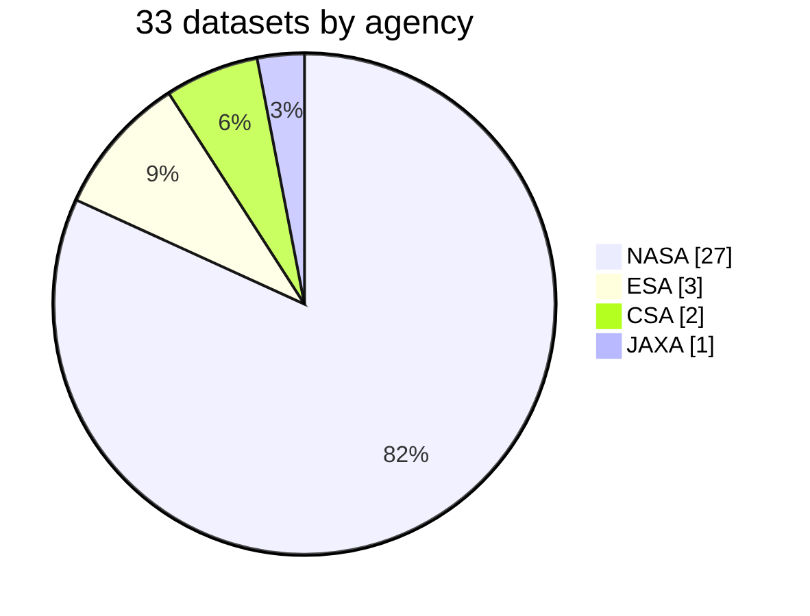

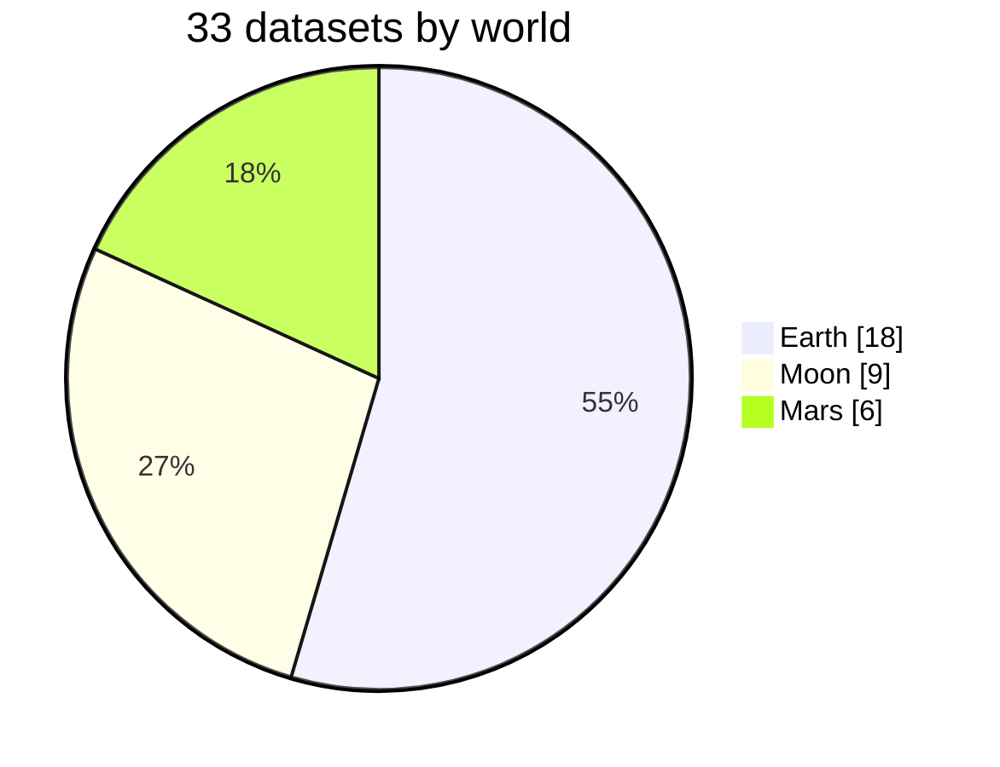

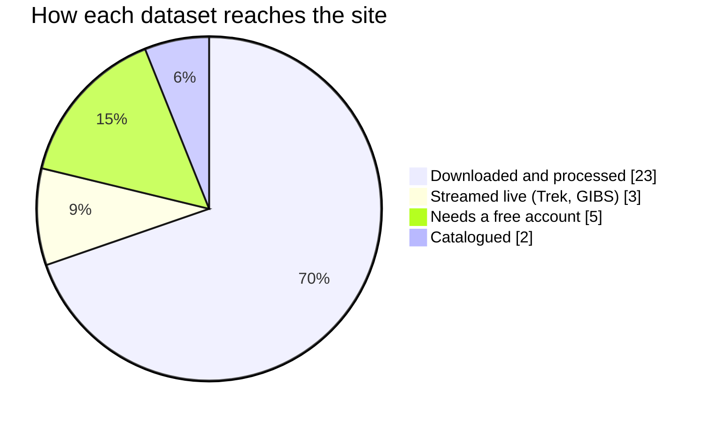

<details>
<summary><b>Extra NASA sources we added beyond the challenge list</b></summary>

| Source | Used for |
|---|---|
| Mars Odyssey **GRS** water-equivalent hydrogen and element maps (Fe, Cl, Si, K, Th) | Mars ice dimension, Explore layers |
| Mars Odyssey **Neutron Spectrometer** epithermal map | Mars ice dimension |
| MGS **TES** thermal inertia (Putzig & Mellon 2007) | Mars "loose vs rocky ground" dimension |
| MGS **MOLA** MEGDR 16 ppd | Mars relief, 3D globe height |
| NASA **Moon Trek** and **Mars Trek** tile services | Live 2D maps |
| NASA **SVS CGI Moon Kit** (LOLA + LROC) | 3D Moon textures and heights |
| **NASA Image and Video Library** | Site photos, game photos (credited on every card) |
| **USGS Gazetteer of Planetary Nomenclature** | Crater and feature labels |
| NASA **3D Resources** | Spacecraft models on the landing page |
| ISS public **TLE** orbit data | Live ISS on the Earth globe |

</details>

---

## 💡 Our answer in one minute

> **TwinWorlds turns "which place on Earth is like the Moon or Mars?" into a measurable, explainable, explorable question.**

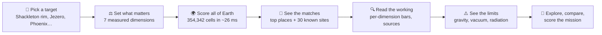

| What makes it different | Why it matters for the challenge |
|---|---|
| 🌍 **Ranks the whole planet, not a shortlist** | Finds *new* analogues instead of re-describing famous ones |
| 🔬 **Translates alien values into Earth terms honestly** | A −230 °C cold trap cannot be matched on Earth, so temperature is compared by *rank within each world*; bare ground, Sun angle and relief are compared in absolute units |
| 🏷 **Evidence levels on every claim** | `confirmed` · `evidence for` · `candidate` · `educational estimate`, each with a source |
| 🧪 **Two ML models with model cards** | Including the result where learned weights do **not** beat hand-set ones, shown openly |
| 🤖 **Rovi, an AI guide that acts** | Claude on Amazon Bedrock with tools: it runs the Finder, samples the Moon map, flies the globe and quotes only numbers its tools returned |
| 🇵🇰 **Pakistan spotlight** | Hingol mud volcanoes, Cholistan, Thar, Khewra salt range: real data for under-studied places |
| ⚡ **Runs on a mid-range laptop** | 3D and maps load only on the pages that need them; scoring runs in a Web Worker |

---

## 🖥 Website tour

<sub>Screenshots of the live site at 1440 × 900.</sub>

### 1. Landing `/`

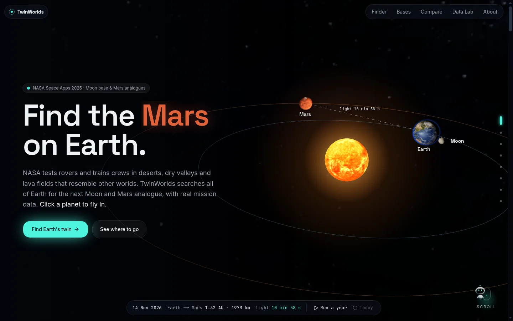

A live 3D solar system using today's planet positions (Earth → Mars distance and light time update with the date),
a rocket launch loader on first visit, a Finder showcase, a Moon pole map, NASA 3D spacecraft and the partner agencies.
**Challenge fit:** presents the problem and invites the visitor to pick a world in the first screen.

### 2. Explore `/explore/earth` · `/explore/moon` · `/explore/mars`

<table>
<tr>
<td width="50%">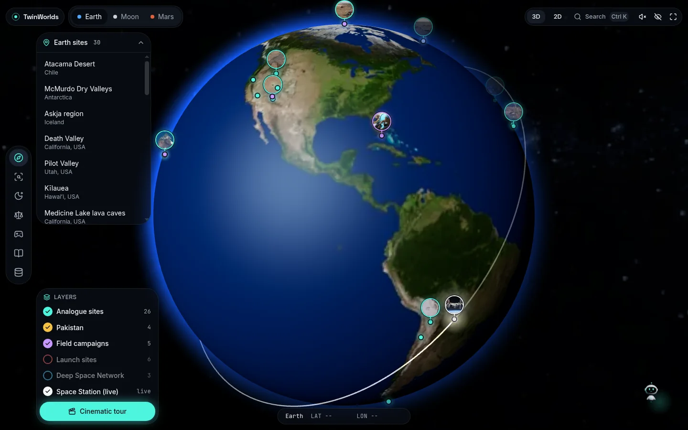</td>
<td width="50%">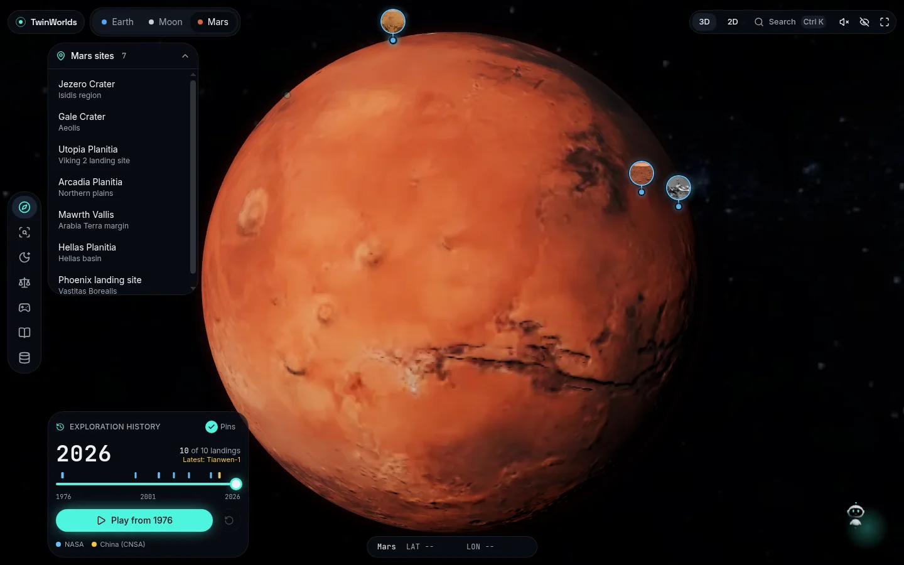</td>
</tr>
</table>

3D globes and 2D NASA tile maps for all three worlds. Earth layers: **29 analogue sites**, Pakistan, field campaigns
(Haughton-Mars Project, Desert RATS, PISCES, NEEMO…), launch sites, the Deep Space Network and the **live ISS**.
Moon and Mars: every landing from 1969/1976 to 2026 on a **timeline slider**. Science layers with legends and click
readouts (Diviner, Mini-RF, Odyssey GRS/NS, TES, MODIS temperature, NDVI, dust, snow), terrain numbers computed live
from LOLA and MOLA, and a **cinematic tour**. **Challenge fit:** the map and visualisation the brief asks for.

### 3. Analog Finder `/finder`

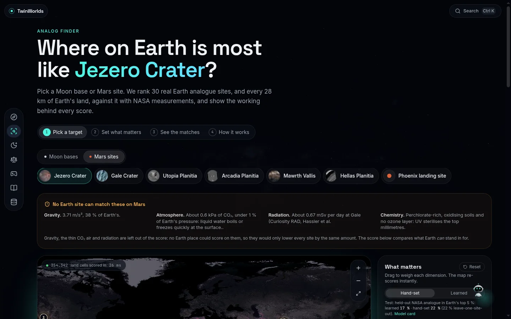

The core of the project. Pick one of 16 Moon or Mars targets, weigh the 7 dimensions, and watch every land cell on
Earth re-score instantly on a heat map. Top places, the known sites ranked as a sanity check, a **site vs target**
breakdown of 13 conditions for any point (temperature, range, radiation, slope, sand, pressure, daylight, rain,
humidity, dust, isolation, elevation, water-formed minerals; climate loads live from **NASA POWER**, soil from
SoilGrids, with every source shown and the conditions no Earth place can reach flagged), a Hand-set ↔ Learned
weights switch, and an **Analogue Space** chart from the ML model.
**Challenge fit:** systematic global search + similarity metric + "what is and isn't analogous".

### 4. Bases `/bases`

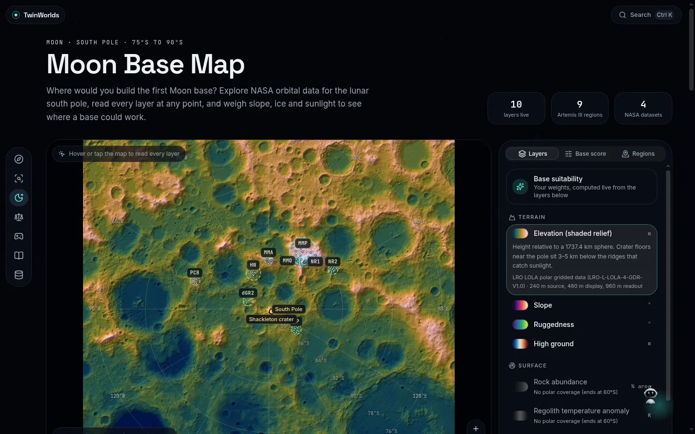

The lunar south pole (75°–90° S) with live layers from LOLA (elevation, slope, ruggedness, high ground), Diviner
(max and mean temperature, ice stability depth, cold traps), Mini-RF radar and LEND hydrogen, the **9 Artemis III candidate regions**,
and a **base-suitability map you weight yourself**, readable at any point. Mars sites get suitability scores too.
**Challenge fit:** connects analogues to *permanent Moon base locations* directly.

### 5. Compare `/compare`

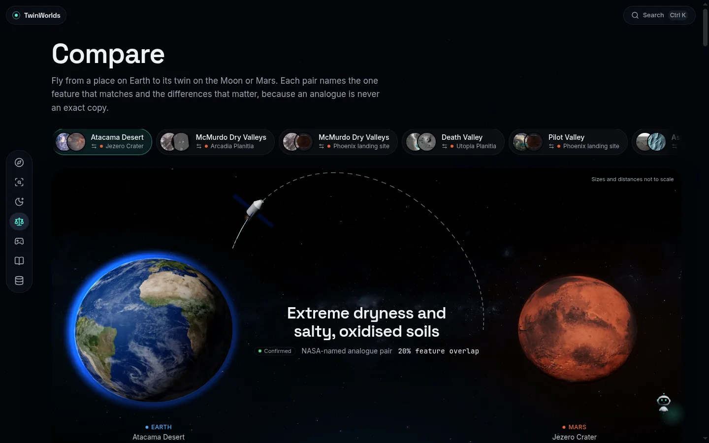

Fly from an Earth site to its Moon or Mars twin. Each pair names the **one shared feature** (e.g. *Extreme dryness and
salty, oxidised soils*), its evidence level and the differences that matter. Below: measured conditions side by side,
**Radar Twins** (CSA RCM vs LRO Mini-RF), and the **Mission Score** for landing, rover or crew missions, with every
factor marked *measured*, *context* or *rule*.

### 6. Models `/models`

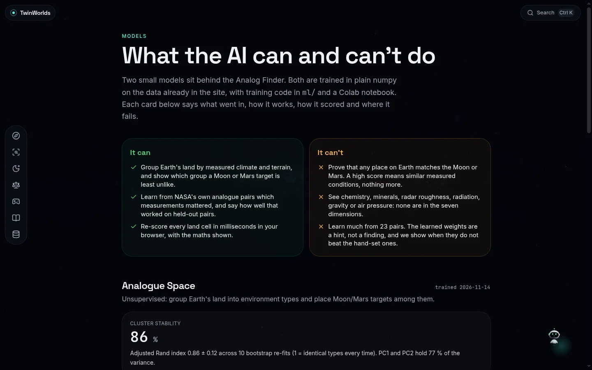

Model cards for both ML models: data, method, test score and limits, plus a plain "It can / It can't" panel.

### 7. Data Lab `/data`

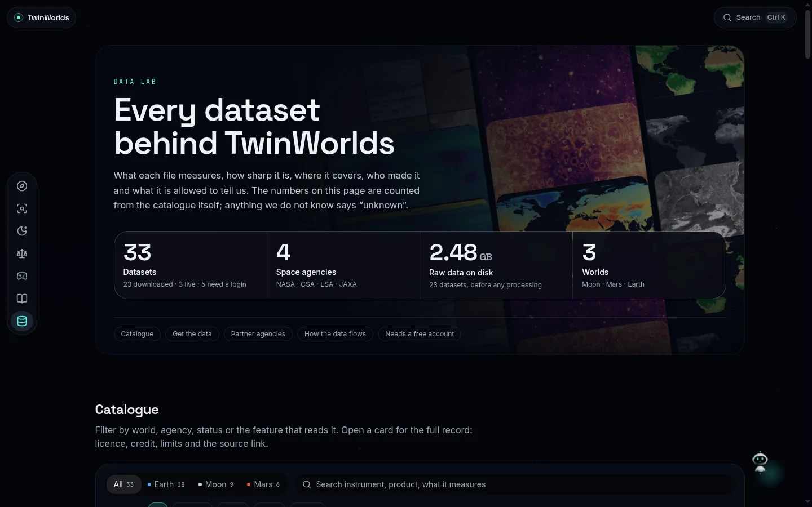

Every dataset with what it measures, resolution, coverage, period, licence, credit, caveats and the source link.
Filter by world, agency, status or the feature that reads it.

### 8. Challenge `/challenge` and Learn `/learn`

<table>
<tr>
<td width="50%">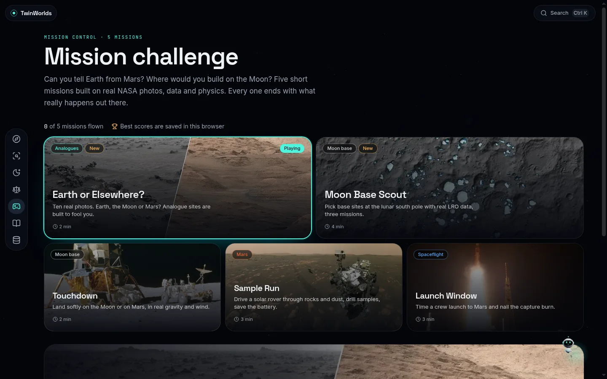</td>
<td width="50%">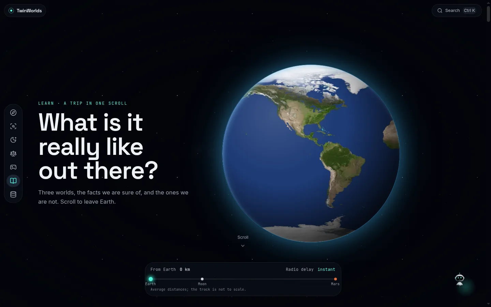</td>
</tr>
</table>

**Five missions** on real data and physics: *Earth or Elsewhere?* (real NASA photos: Earth, Moon or Mars?),
*Moon Base Scout* (pick base sites with LRO data), *Touchdown* (land in real Moon/Mars gravity and wind),
*Sample Run* (solar rover and battery) and *Launch Window* (time a Mars transfer). **Learn** compares the three
worlds side by side, with a glossary and the full source list. **Challenge fit:** public education, which the brief
asks for.

### 9. Rovi, the AI mission guide (every page)

A small robot in the corner of every page. Ask it *"Which Earth place is most like a Moon base at Haworth, and why?"*
and it **runs the Finder**, **samples the Moon map**, moves the camera and spotlights the panel it is talking about.
It has a guided tour, voice in and out, and a scripted demo mode that works without any API key.

---

## 🏆 Where each judging criterion is met

| Criterion | Evidence in TwinWorlds |
|---|---|
| **Impact** | A reusable, open method to search the whole planet for analogues; a Moon Base map built on the Artemis III regions; education through games and Learn; under-studied regions (Pakistan) brought in |
| **Creativity** | Whole-Earth ranking with rank-based translation between worlds; Radar Twins; an AI robot that operates the site; cinematic globe tours; Analogue Space chart |
| **Validity** | Measured NASA data in every score; evidence levels; per-factor *measured / context / rule* labels; model cards with leave-one-pair-out validation; explicit "Earth cannot match" panels |
| **Relevance** | Uses 8 of the 10 listed challenge resources plus 10 more NASA sources; targets real Artemis III and Mars landing sites |
| **Presentation** | Polished dark space UI, 3D globes, one identity colour per world, keyboard navigation, reduced-motion support, fast on mid-range laptops |

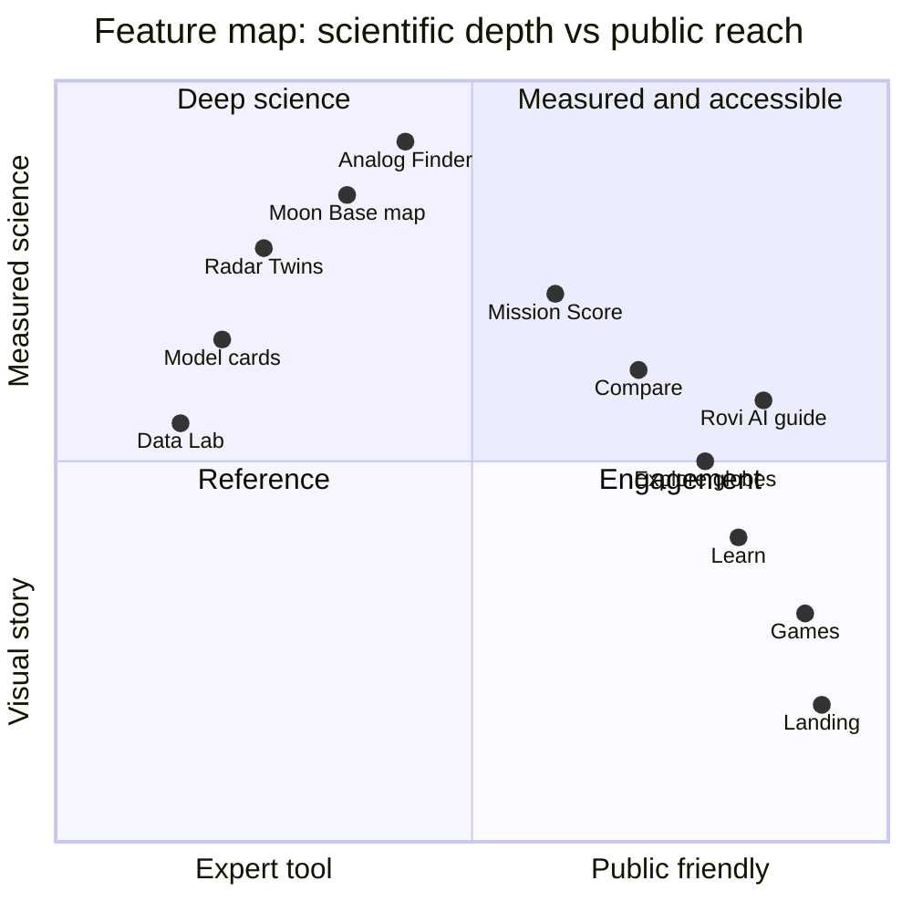

<sub>Placement is our own design judgement, not a measurement.</sub>

---

## 🔬 The science: how a score is made

### Seven measured dimensions

| Dimension | Mode | Earth data | Moon data | Mars data |
|---|:-:|---|---|---|
| ❄️ **Cold** | rank | MODIS LST mean | Diviner: share of the Moon colder (latitude) | share of Mars colder (latitude) |
| 🌗 **Day–night swing** | rank | MODIS day − night LST | Diviner / polar low Sun | energy balance on TES inertia |
| 🪨 **Bare & lifeless** | absolute | MODIS NDVI (target = 0) | none (no plants) | none (no plants) |
| 🧱 **Loose vs rocky ground** | rank | apparent thermal inertia (MODIS LST + MCD43C3 albedo) | Diviner rock abundance | TES thermal inertia |
| 🧊 **Frozen ground / ice** | rank | freezing degree-months | Diviner PRP ice stability near cold traps | Odyssey neutron hydrogen |
| ☀️ **Sun angle** | absolute | highest noon Sun (latitude + tilt) | latitude, 1.5° tilt | latitude, 25.2° tilt |
| 🏔 **Terrain relief** | absolute | JAXA AW3D30 (std over ~66 km) | LOLA | MOLA |

**Why "rank" mode?** The Moon's polar cold traps fall below −230 °C; the coldest ground on Earth is about −98 °C.
No Earth place can match that number, so for cold, swing, inertia and ice we compare **percentiles within each world**:
"as cold for Earth as Shackleton's rim is for the Moon". Bare ground, Sun angle and relief can be compared directly.

### The scoring formula

$$
S_{\text{cell}} \;=\; \frac{\sum_{d} w_d \, s_d(\text{cell})}{\sum_d w_d}
\qquad s_d \in [0,1] \text{ is the closeness of the cell to the target on dimension } d
$$

The same formula drives the Moon Base map: $\text{suitability} = \sum_i w_i \, s_i(\text{layer}_i) / \sum_i w_i$ over
*gentle slope, even ground, cold trap nearby, sunlit ground, high ground* and *few blocky rocks (radar)*.

### Default weights vs what the ML learned

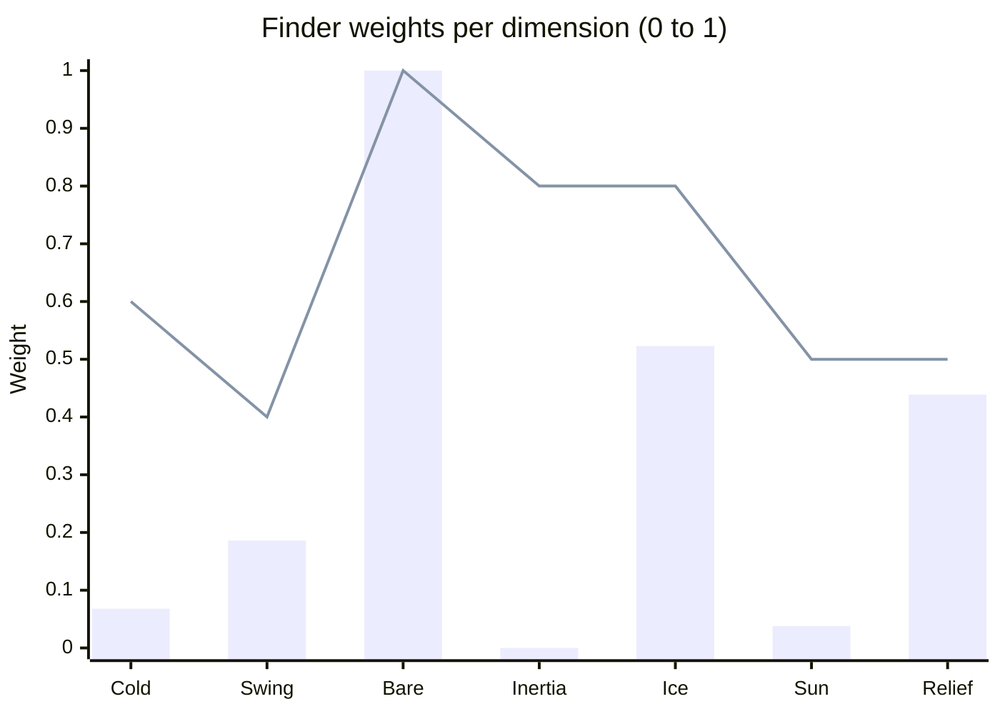

<sub>Bars: weights learned from 23 NASA analogue pairs. Line: our hand-set Mars defaults. Both are in `public/data/ml/learned-weights/` and `lib/finder/text.ts`.</sub>

### Where Earth breaks down (shown on every target)

| | Moon | Mars | Why it is left out of the score |
|---|---|---|---|
| **Gravity** | 1.62 m/s² (⅙ g) | 3.71 m/s² (38 %) | Same for every Earth place, so it would lower all scores equally |
| **Atmosphere** | Vacuum | ~0.6 kPa CO₂ (<1 % of Earth) | No Earth surface has it |
| **Radiation** | Unshielded: no field or air (LRO CRaTER) | ~0.67 mSv/day (Curiosity RAD) | Earth's field and air block it |
| **Chemistry** | Reduced, no water-altered minerals | Perchlorates, oxidising soil, no ozone | Not in the 7 climate-and-terrain dimensions |

---

## 🧠 Machine learning

Two small models, trained in plain NumPy (`ml/`, plus a Colab notebook `ml/TwinWorlds_ML.ipynb`) on data already in the
site. Outputs and model cards: `public/data/ml/`.

| | **M1 · Analogue Space** | **M2 · Learned weights** |
|---|---|---|
| Task | Unsupervised: group Earth's land into environment types and place Moon/Mars targets among them | Supervised: learn how much each Finder dimension matters for a real NASA analogue pair |
| Data | 354,342 land cells (MODIS LST, NDVI, albedo; AW3D30) + 16 targets | 23 NASA-recognised pairs (Atacama–Jezero, McMurdo–Phoenix, Devon–Haughton, Rio Tinto–Mawrth…) vs random cells |
| Method | Area-weighted standardisation → PCA → weighted k-means (k = 8, k-means++, best of 6) | Non-negative logistic regression, L2 penalty, projected gradient descent |
| Score | **Cluster stability ARI 0.86 ± 0.12** (10 bootstraps); PC1+PC2 hold **77 %** of variance | **Recall@top 5 %: 17 %** (leave-one-pair-out) vs **22 %** hand-set |
| Honest limit | Targets sit far outside Earth's range; the nearest type is the *least unlike*, not a match | Only 23 pairs; NASA chose many sites for chemistry or logistics the 7 dimensions cannot see |

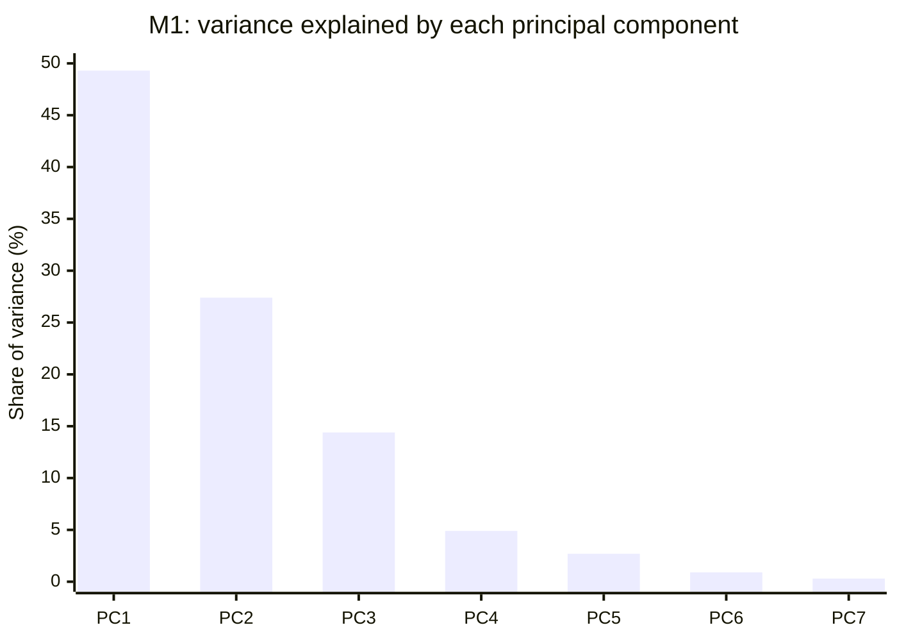

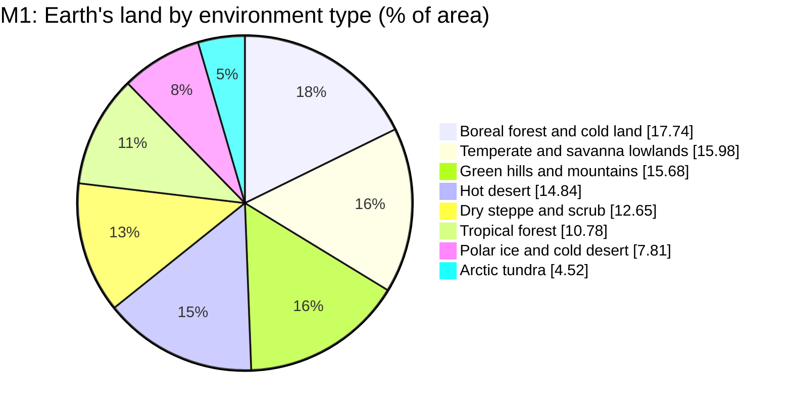

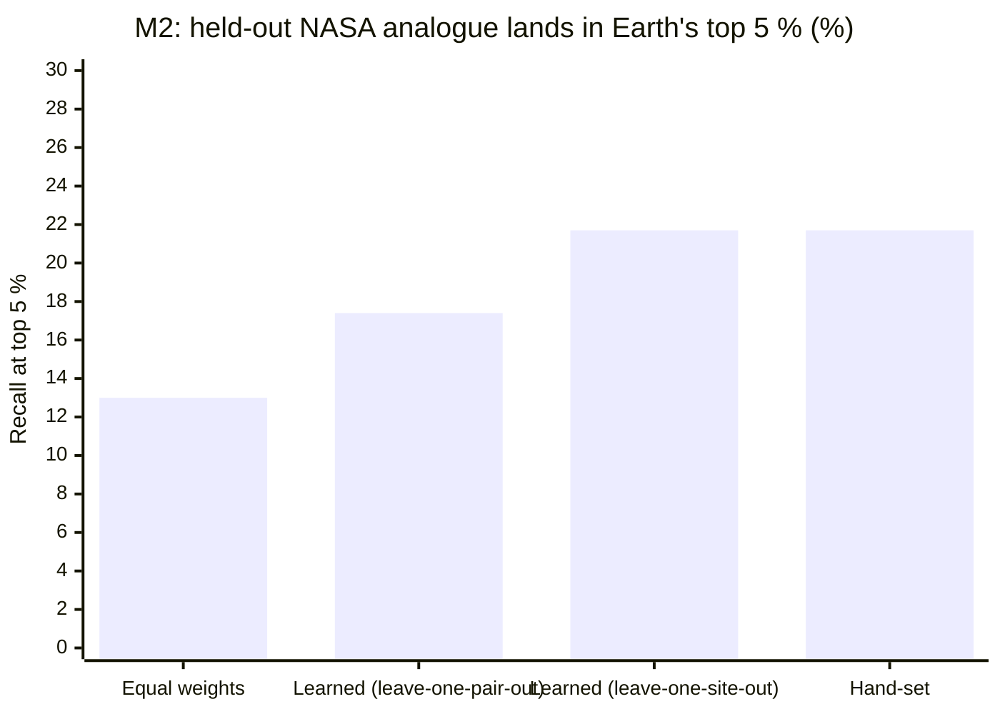

> We ship the hand-set weights as the default because the learned ones did not beat them. The switch is in the Finder
> so anyone can compare; the Models page says so plainly.

---

## 🏗 System design

### Architecture

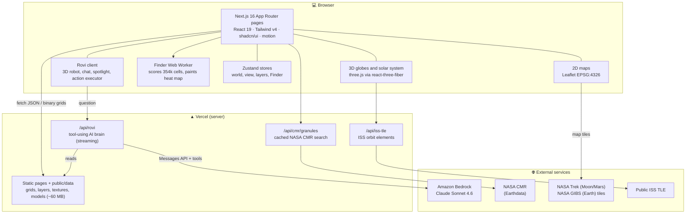

### Data pipeline: from agency archives to the browser

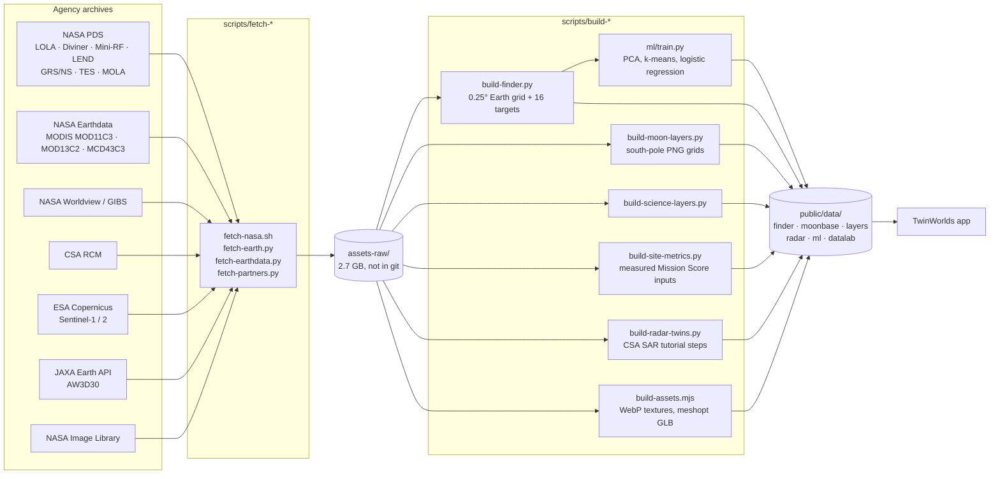

### How a Finder query runs

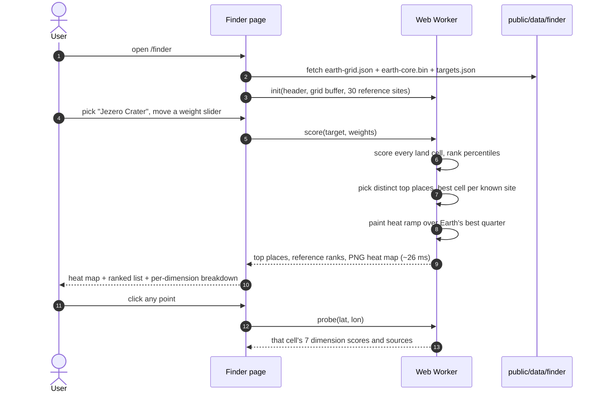

### How Rovi answers and acts

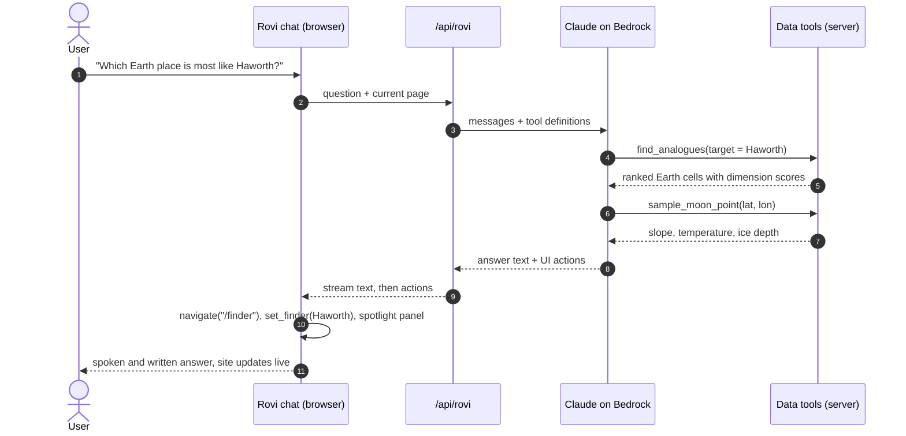

**Data tools:** `find_analogues`, `sample_moon_point`, `list_artemis_regions`, `score_site`, `compare_sites`,
`get_dataset`, `list_sites`. **UI actions:** `navigate`, `fly_globe`, `open_map_layer`, `set_finder`,
`place_moon_base`, `start_game`, `start_tour`, `show_explainer`. Rules: numbers only from tools, "no data" when a
tool returns nothing, and a scripted demo mode when no AWS key is set (`AI_MODE=demo`).

### Performance strategy

| Technique | Effect |
|---|---|
| three.js and Leaflet load **only** on the pages that use them, and only the active view | Light landing page and fast first paint |
| Finder scoring in a **Web Worker** on a quantised binary grid | 354k cells re-score in ~26 ms without blocking the UI |
| Globe renders **on demand**, clamps DPR, drops to 1k textures if frame rate collapses | Smooth on integrated GPUs |
| Texture tiers 1k / 2k / 4k WebP chosen by `detect-gpu` | Right quality per device |
| GLB models **meshopt**-compressed with WebP textures | 87 MB → 9.7 MB |
| Next.js **Cache Components** + `"use cache"` on the CMR route | Shared server cache for NASA queries |

### Tech stack

| Layer | Tools |
|---|---|
| Framework | **Next.js 16** (App Router, Cache Components, React View Transitions), **React 19**, **TypeScript** |
| Styling & UI | **Tailwind CSS v4**, shadcn/ui (Radix, RTL-ready), Magic UI, `motion`, Sonner |
| 3D | three.js, `@react-three/fiber`, `@react-three/drei`, `@react-three/postprocessing` |
| Maps & geo | Leaflet + react-leaflet (EPSG:4326), d3-geo, topojson-client, satellite.js |
| State & audio | Zustand, Howler |
| AI | `@anthropic-ai/bedrock-sdk`, Claude Sonnet 4.6 on Amazon Bedrock |
| Data & ML | Python (NumPy, Pillow), Node + sharp + glTF-Transform + meshoptimizer asset pipeline |
| Hosting | Vercel (every push to `main` redeploys) |

### Repository layout

```
app/                 routes: / · /explore/{earth,moon,mars} · /finder · /bases · /compare · /challenge
                     /learn · /data · /models · /about · api/{rovi,cmr,iss-tle}
components/
  globe/             3D globe: planet, atmosphere and night-light shaders, pins
  map/               2D Leaflet map with NASA Trek / GIBS layers
  finder/            Analog Finder UI, heat map, Analogue Space chart
  moonbase/          south-pole layer map, suitability, Artemis regions
  compare/ score/    pair view, Radar Twins, Mission Score
  challenge/         5 games (canvas engine, sfx)
  rovi/              AI robot: 3D bot, chat panel, spotlight
  landing/ learn/ datalab/ shell/ ui/
lib/
  finder/            grid decoding, scoring model, Web Worker
  moonbase/          grids, projection, suitability
  rovi/              actions, page handlers, conductor; server/ brain + tools
  data/              sites, twins, datasets catalogue, metrics, landings
ml/                  training scripts, notebook, analogue pairs
scripts/             fetch-* (download) and build-* (process) pipeline
public/data/         processed grids, layers, ML outputs served to the site
public/brand/        TwinWorlds logo (SVG) and app icons
docs/                README banner, screenshots, archived plans
```

---

## 🚀 Run it locally

```bash
git clone https://github.com/TayyabXtreme/Twin_World_Nasa_Space_APP_Challenge_2026.git
cd Twin_World_Nasa_Space_APP_Challenge_2026
npm install          # Node 22+
npm run dev          # http://localhost:3000
```

Everything the site serves is already committed in `public/`, so no data download is needed to run it.

**Optional, for Rovi's live AI brain:** copy `.env.example` to `.env.local` and fill in `AWS_REGION`,
`AWS_ACCESS_KEY_ID`, `AWS_SECRET_ACCESS_KEY` and `BEDROCK_MODEL_ID`. Without them Rovi runs its scripted demo.

| Command | What it does |
|---|---|
| `npm run dev` | Dev server (Turbopack) |
| `npm run build` · `npm start` | Production build · serve |
| `npm run assets` | `assets-raw/` → `public/` (only stale files). Steps: `textures heightmaps data photos models audio` |
| `npm run assets:force` | Rebuild every asset |
| `npm run typecheck` · `npm run lint` · `npm run format` | Quality checks |

<details>
<summary><b>Rebuilding the data from the raw archives</b></summary>

The raw source data (`assets-raw/`, about 2.7 GB of NASA PDS, Earthdata, CSA, ESA and JAXA files) is too large for git.
Get it from the [team Drive folder](https://drive.google.com/drive/folders/1PM2xNfexc70k4MoYxb6B1MY_4sM-DNub) and unzip
it into `assets-raw/`, or download it again:

```bash
bash scripts/fetch-nasa.sh
python -I scripts/fetch-earth.py
python -I scripts/fetch-earthdata.py     # needs EARTHDATA_TOKEN (free Earthdata login)
python -I scripts/fetch-partners.py
```

Then rebuild with `npm run assets` and the `scripts/build-*.py` scripts, and retrain with `python ml/train.py`.

</details>

**Deploy:** import the repo in Vercel and keep the defaults (framework Next.js, `npm run build`). Add the AWS variables
only if you want Rovi's live brain.

> Next.js 16 differs from older versions. Read `node_modules/next/dist/docs/` before changing routing or caching
> (see `AGENTS.md`).

---

## 🗓 Build log

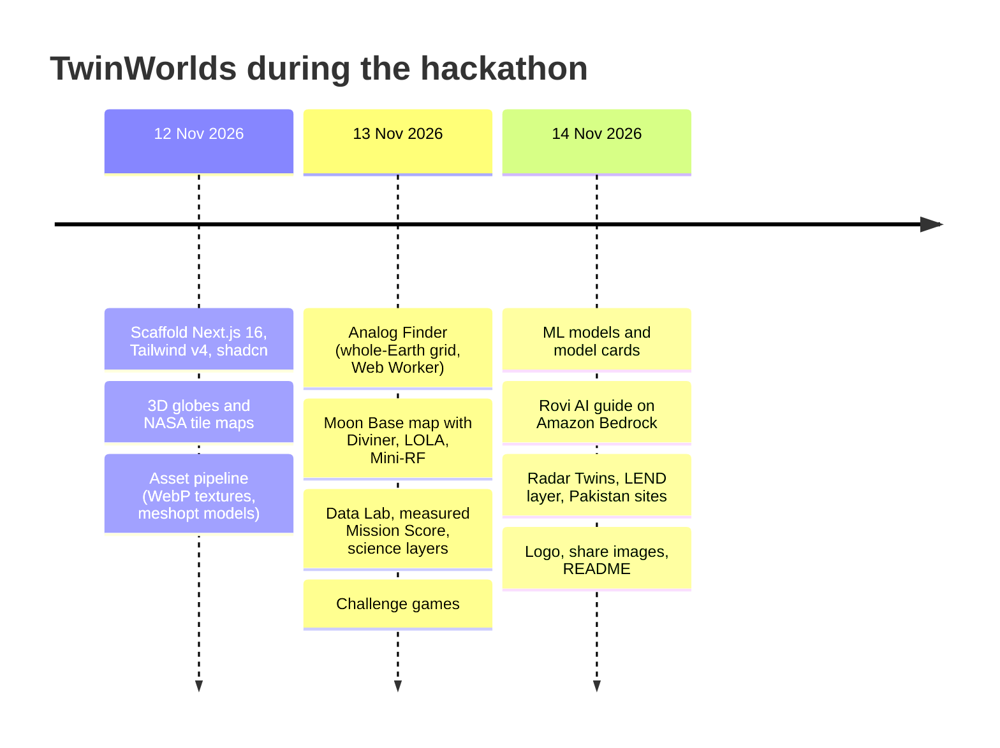

---

## 🙏 Data credits

NASA PDS Geosciences Node (LRO LOLA, Diviner, Mini-RF, LEND; Mars Odyssey GRS/NS; MGS TES and MOLA), NASA LP DAAC /
Earthdata (MODIS), NASA Worldview and GIBS, NASA Moon Trek and Mars Trek, NASA SVS CGI Moon Kit, NASA Image and Video
Library, NASA 3D Resources, USGS Gazetteer of Planetary Nomenclature, Natural Earth, **Canadian Space Agency** (RCM),
**European Space Agency** (Copernicus Sentinel-1 and Sentinel-2), **JAXA** (ALOS AW3D30 via the JAXA Earth API).
Per-file credits: `assets-raw/photos/**/CREDITS.csv`, `assets-raw/data/SOURCES.txt`,
`assets-raw/textures/SOURCES_ELEVATION.txt`, and every card in the Data Lab.

<sub>NASA does not endorse any non-U.S. Government entity and is not responsible for information contained on
non-U.S. Government websites. The Mission Score is an educational index, not NASA site selection.</sub>

<div align="center">
<br/>
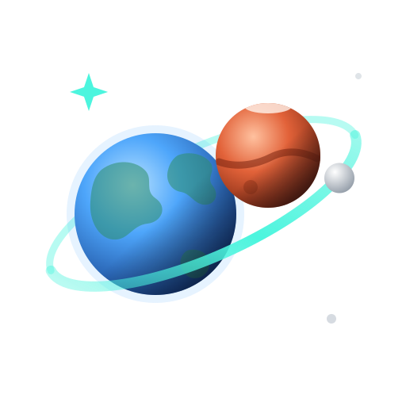
<br/>
<b>TwinWorlds</b> · NASA Space Apps Challenge 2026
<!-- Add team member names and roles here. -->
</div>
