# TwinWorlds – AI-assisted search for the Moon and Mars on Earth

## Summary

TwinWorlds is a planetary-analog discovery platform that searches **every land cell on Earth (354,342 of them)** for the places that best stand in for future Moon-base locations and Mars landing sites. NASA tests rovers, instruments and crews at Earth analogs such as the Atacama Desert, Haughton Crater and Death Valley. But teams keep going back to the same famous sites, and those sites are not well characterised. TwinWorlds replaces habit with measurement. It combines **33 open datasets from NASA, ESA, JAXA and CSA** and scores each place on **7 measured dimensions**: cold, day–night swing, bare ground, loose vs rocky ground, frozen ground, Sun angle and terrain relief. It does this for **16 real targets**, from the Shackleton crater rim at the lunar south pole to Jezero Crater on Mars, and it re-ranks the whole planet in about 26 ms. Every match shows **why it works and where it breaks down**: gravity, vacuum, radiation and chemistry are flagged on every target because no place on Earth can reproduce them. Four connected pages (Explore, Analog Finder, Compare and Bases) take a user from a global search down to a mission decision. Along the way, TwinWorlds surfaced rarely studied analogs such as Namibia's Skeleton Coast, Greenland's ice margin and the Karakoram in Pakistan.

## Project Demonstration

`<paste demo video link here>`

## Project

https://twinworld-topaz.vercel.app/

**GitHub:** https://github.com/TayyabXtreme/Twin_World_Nasa_Space_APP_Challenge_2026

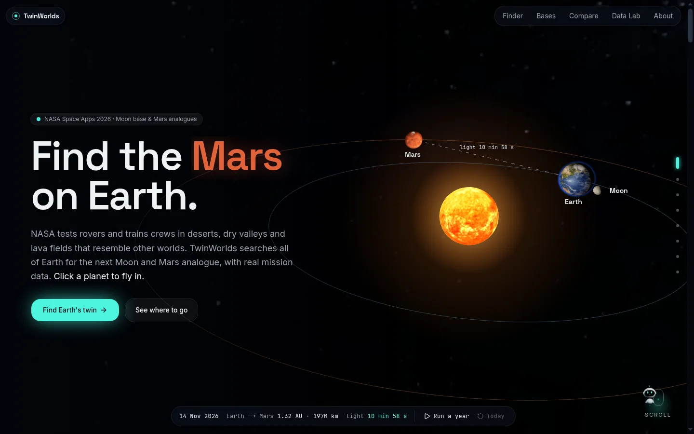

---

## Project Details

### 1. Detailed Project Description

#### What TwinWorlds Does

TwinWorlds is an end-to-end analog-discovery platform. It processes raw agency archives into a compact global grid: MODIS temperature, vegetation and albedo for Earth; LRO LOLA, Diviner, Mini-RF and LEND for the Moon; and Odyssey GRS/NS, MGS TES and MOLA for Mars. It then compares Earth with the Moon and Mars on equal terms. A user picks a Moon or Mars site and decides how much each condition matters. They immediately get a heat map of the whole Earth, the top matching places, a ranking of 30 well-known analog sites, and a per-dimension breakdown with the source of every number. **No imagery is used in the score.** Two places can look alike and still differ in temperature, ground type or ice, so TwinWorlds scores only measured values.

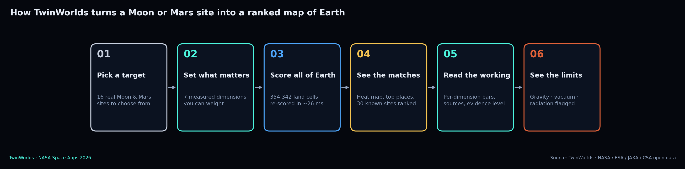

#### How It Works – Key Technical Innovations

- **Rank-based translation between worlds:** Lunar cold traps fall below −230 °C, and the coldest ground on Earth is about −98 °C. No place on Earth can match that number. So for cold, day–night swing, ground type and ice, TwinWorlds compares **percentiles within each world**: *"as cold for Earth as Shackleton's rim is for the Moon."* Bare ground, Sun angle and terrain relief are compared directly in real units.
- **Seven measured dimensions:** each dimension pairs an Earth dataset with a Moon or Mars dataset:

| Dimension | Earth data | Moon data | Mars data |
|---|---|---|---|
| Cold | MODIS land-surface temperature | LRO Diviner | latitude model |
| Day–night swing | MODIS day − night temperature | Diviner / polar low Sun | energy balance on TES inertia |
| Bare & lifeless | MODIS NDVI | no plants | no plants |
| Loose vs rocky ground | thermal inertia (MODIS + MCD43C3 albedo) | Diviner rock abundance | MGS TES thermal inertia |
| Frozen ground / ice | freezing degree-months | Diviner ice stability | Odyssey neutron hydrogen |
| Sun angle | noon Sun (latitude + tilt) | 1.5° tilt | 25.2° tilt |
| Terrain relief | JAXA ALOS AW3D30 | LRO LOLA | MGS MOLA |

- **Transparent scoring formula:** Score = Σ (weight × closeness on each dimension) ÷ Σ weights, with closeness from 0 to 1. Every weight is a slider, so the user can see exactly how each assumption moves the map.
- **Whole-planet search in about 26 ms:** the Earth grid is stored as a quantised binary file (0.25°, ~28 km cells) and scored in a **Web Worker**, so all 354,342 cells re-rank without freezing the page.
- **Evidence levels on every claim:** *confirmed · evidence for · candidate · educational estimate*, each with a source link. Every Mission Score factor is labelled *measured*, *context* or *rule*.
- **Live NASA data:** the Finder's site-vs-target panel pulls climate from **NASA POWER**, and the Data Lab searches **NASA CMR** live through our own cached API.

#### The Four Core Pages

**Explore – see the three worlds.** 3D globes and NASA tile maps for Earth, the Moon and Mars. The Earth globe shows 29 analog sites, NASA field campaigns (Haughton-Mars Project, Desert RATS, PISCES, NEEMO) and the live ISS. A timeline slider steps through every Moon and Mars landing from 1969 to 2026. Science layers include Diviner, Mini-RF, Odyssey GRS, TES, MODIS temperature, NDVI, dust and snow.

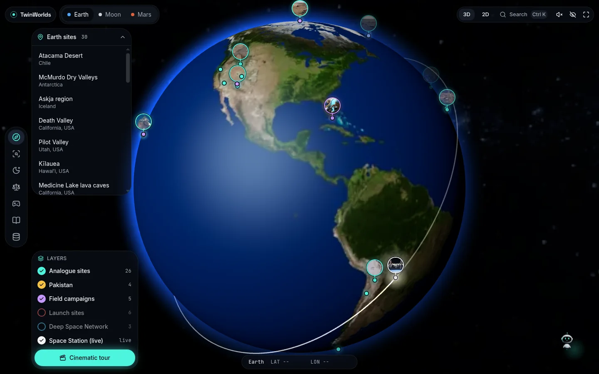
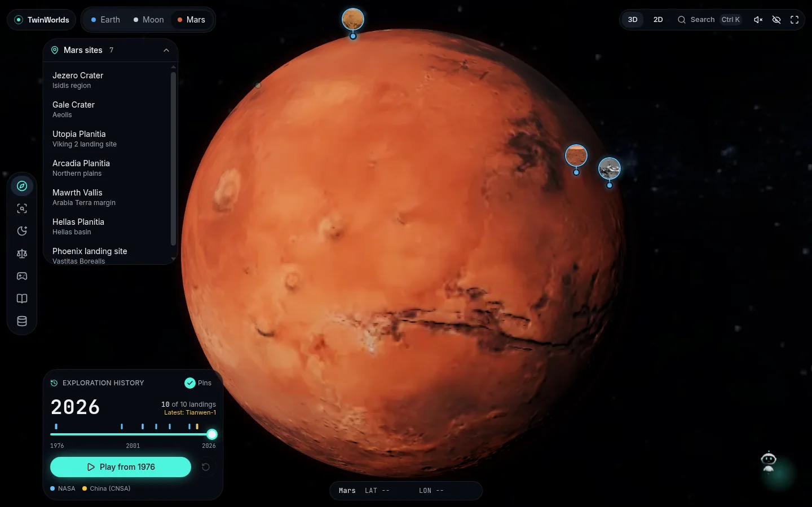

**Analog Finder – the core of the project.** Pick one of 16 targets and set the weight of each of the 7 dimensions, and the whole planet is re-ranked instantly. Click any point for a site-vs-target breakdown of 13 conditions.

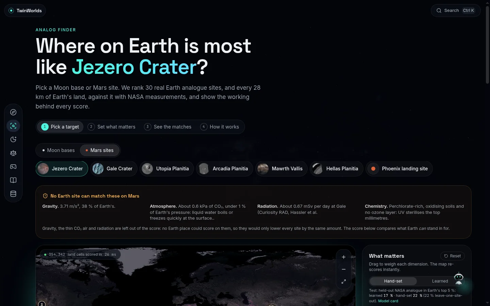

**Compare – one Earth site vs its twin.** Fly from an Earth site to its Moon or Mars twin. Each pair shows the one feature they share, how strong the evidence is, and the differences that matter, plus **Radar Twins** and a **Mission Score** for landing, rover and crew operations.

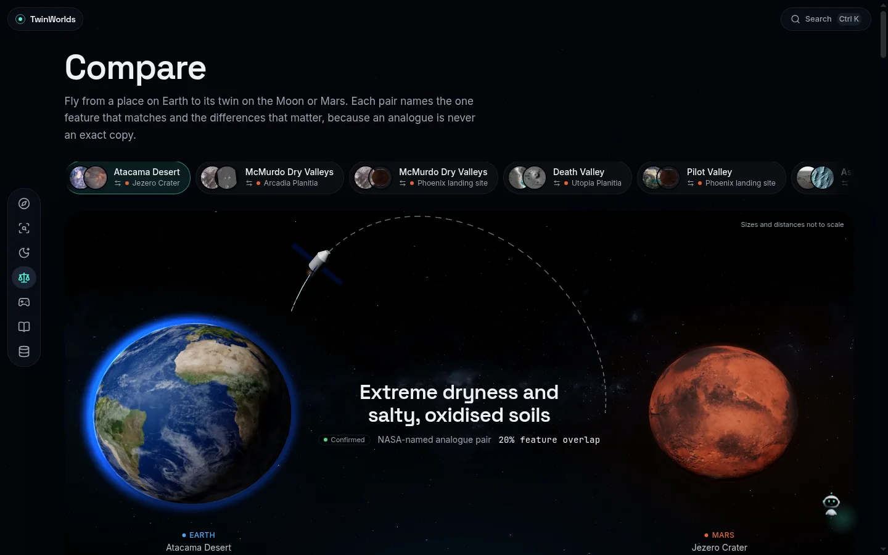
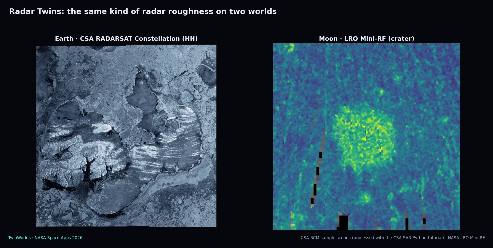

**Bases – from analog to Moon base.** The lunar south pole from 75°S to 90°S, with LOLA, Diviner, Mini-RF and LEND layers, the **9 Artemis III candidate regions** and a base-suitability map whose weights the user sets.

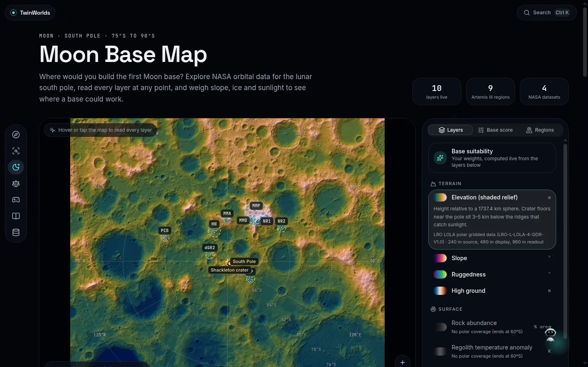
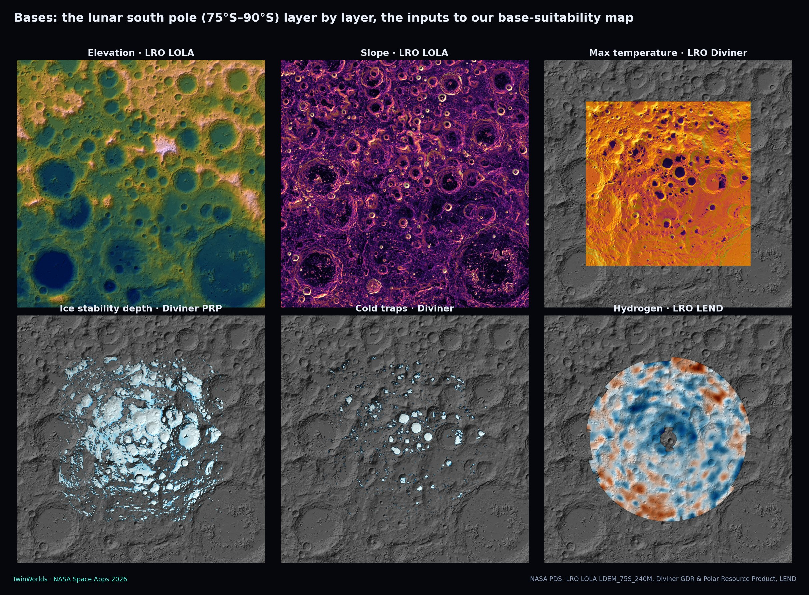

---

### Benefits and Goals

TwinWorlds delivers immediate value by turning analog selection from a short list of familiar places into a **measured search of the whole planet**. Mission teams can match a test site to the exact Moon or Mars location they are preparing for, see which conditions match and which do not, and pick the right site for each test: a cold site for thermal tests, a bare site for rover traverses, a frozen site for drilling. Scientists get an open, reproducible similarity method. The public gets an interactive way to learn how we prepare for the Moon and Mars, with five mini-games built on real data and physics. In the long run, TwinWorlds aims to **widen the map of analog science**, bringing in places from the Global South such as Namibia, Peru, Iran and Pakistan that have received far less attention than Antarctica or the Atacama.

---

### Presenting Analog Finder Results

#### Representative Case Study – Jezero Crater, Mars

- **The question:** Perseverance is exploring Jezero, an ancient lake delta. Where on Earth is most like it?
- **Search:** with the default Mars weights, all 354,342 land cells were scored. The top five distinct places are the **Skeleton Coast, Namibia (92)**, the **Atacama coast, Chile (92)**, the **coastal desert of Peru (91)**, the **Namib Sand Sea (91)** and the **Anti-Atlas, Morocco (90)**.
- **Why the Skeleton Coast ranks #1:** it scores 1.00 on cold rank, 0.98 on day–night swing, 0.92 on bare ground, 1.00 on Sun angle and 1.00 on terrain relief. **Its weak point is ground type (0.67).** TwinWorlds shows this weakness instead of hiding it.
- **Comparison with a NASA test site:** Death Valley, where Mars 2020 hazard avoidance was tested, scores **80**. It matches well on cold and swing, but it loses on bare ground (0.44) and Sun angle (0.46).
- **Robustness:** NASA's own Atacama–Jezero pairing ranks in Earth's **top 2.0 %** with hand-set weights and climbs to the **top 0.11 %** with weights learned from NASA analog pairs. The method agrees with NASA's choice under both sets of weights.

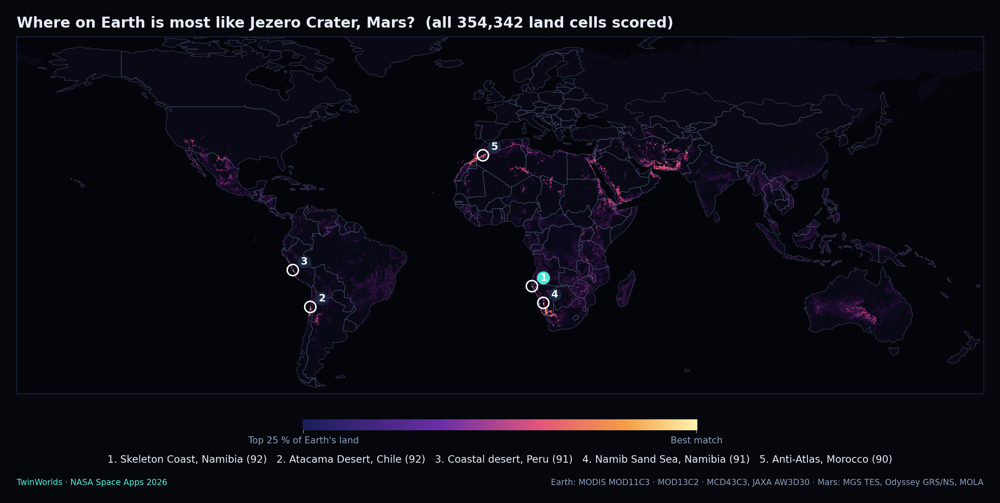
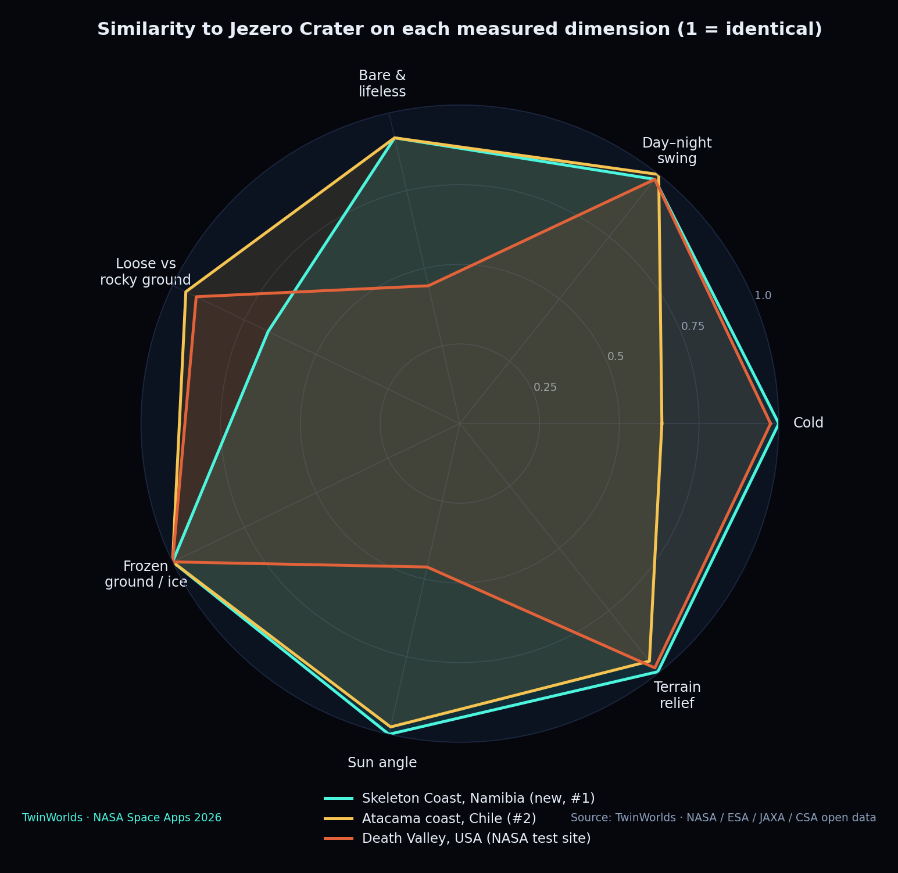

#### Different Targets, Different Earths

Every target lights up a different part of the planet. Jezero points to coastal deserts. Gale points to high, cold, dry mountains. Phoenix points to Greenland and Antarctica. The lunar south pole points almost entirely to Antarctica.

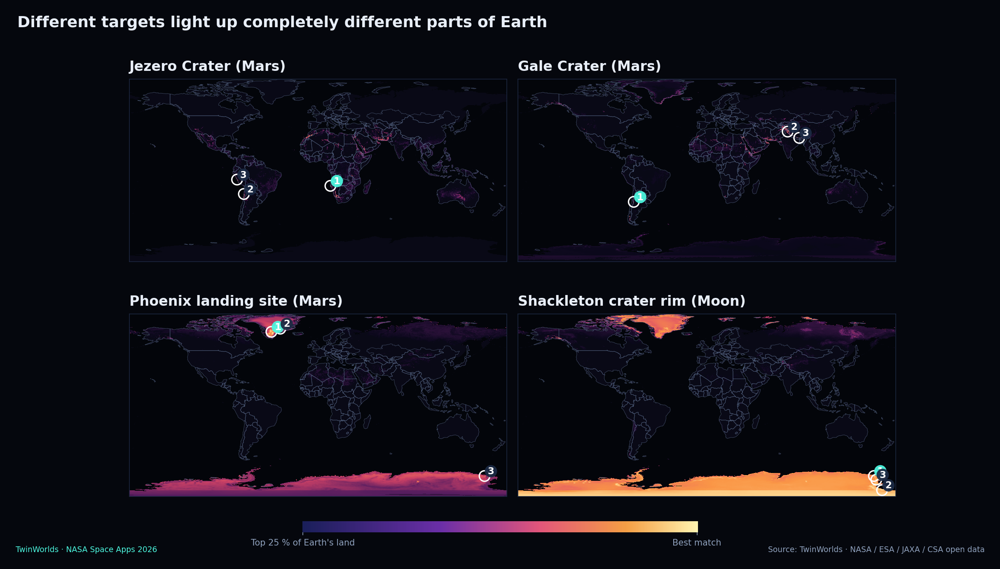

| Target | Best Earth match found | Score | Best well-known analog |
|---|---|:-:|---|
| Jezero Crater (Mars) | Skeleton Coast, Namibia | **92** | Namib Sand Sea, 84 |
| Phoenix site (Mars) | Greenland ice-sheet margin | **91** | McMurdo Dry Valleys, 64 |
| Utopia Planitia (Mars) | Lower Amur, Russian Far East | **89** | Ladakh, 70 |
| Marius Hills pit (Moon) | Dasht-e Kavir, Iran | **89** | Atacama / Death Valley, 80 |
| Hellas Planitia (Mars) | Black Rock Desert, Nevada | **81** | Mars Desert Research Station, 75 |
| Mawrth Vallis (Mars) | Ladakh–Spiti, India | **80** | Namib Sand Sea, 73 |
| Shackleton rim (Moon) | Northern Victoria Land, Antarctica | **77** | McMurdo Dry Valleys, 74 |
| Gale Crater (Mars) | High Andes near Aconcagua, Argentina | **75** | Dallol, Ethiopia, 67 |

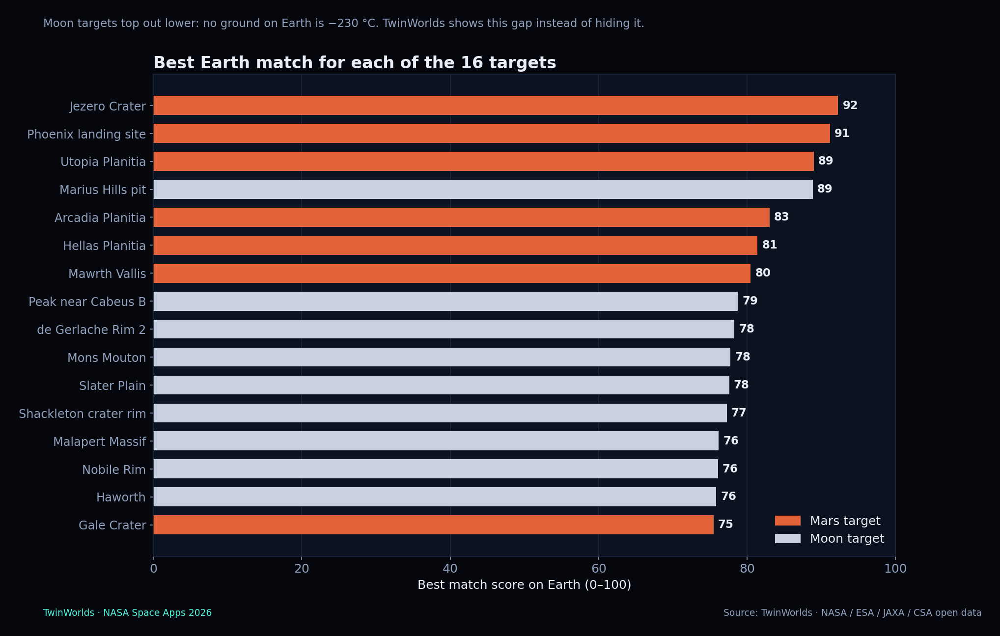

#### Gale Crater & the Pakistan Discovery

For Gale Crater, where the Curiosity rover is exploring, the **Karakoram in Gilgit-Baltistan, Pakistan (36.6°N, 75.1°E)** ranks among the **top 5 places on Earth (score 73)**. That puts it ahead of famous analogs such as Dallol (67), Death Valley (65) and the Atacama. It sits close to Ladakh, which ISRO already uses as an analog. TwinWorlds also has a **Pakistan spotlight** with real data for Hingol's mud volcanoes, the Cholistan and Thar deserts and the Khewra Salt Range.

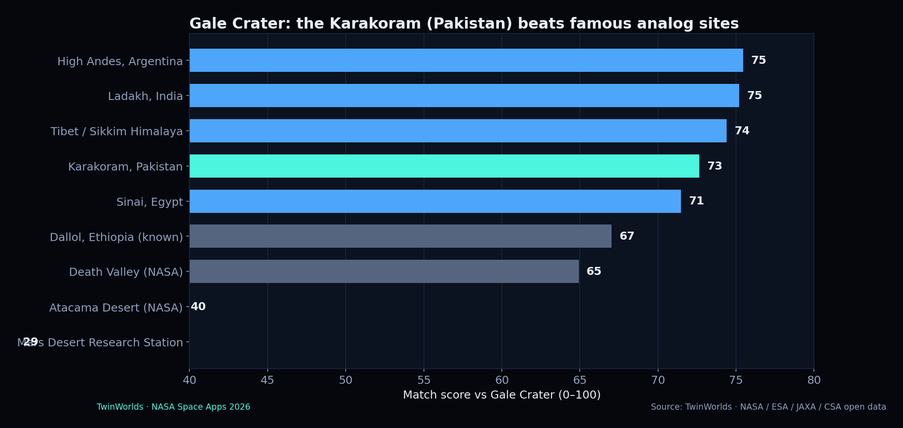

#### Honest Check Against NASA's Own Analogs

We tested the method on **23 analog pairs that NASA recognises**. Five land in Earth's top 5 % and the best in the top 0.4 %. Others rank lower, because NASA chose many sites for **chemistry or logistics**, which climate and terrain data cannot see. We show this openly, because it tells mission planners exactly what the score measures and what it does not.

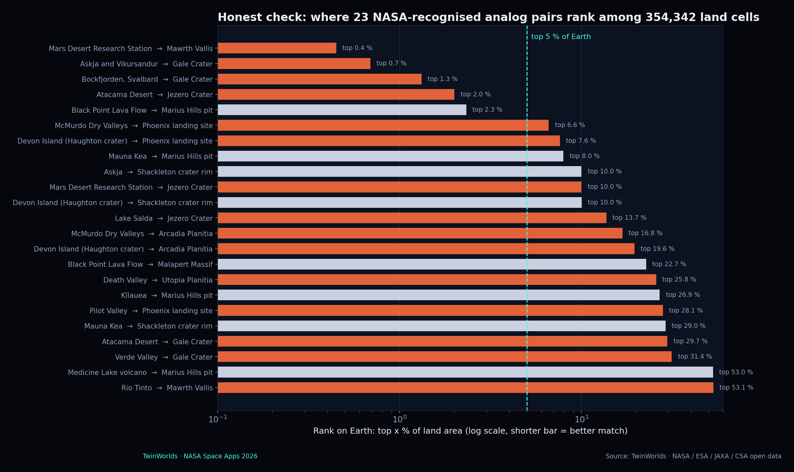

#### Where the Analogy Breaks Down

No place on Earth reproduces lunar gravity, the lunar vacuum, the thin CO₂ air of Mars or the radiation on either surface. These are left out of the score, and **every target opens with a panel that explains them**.

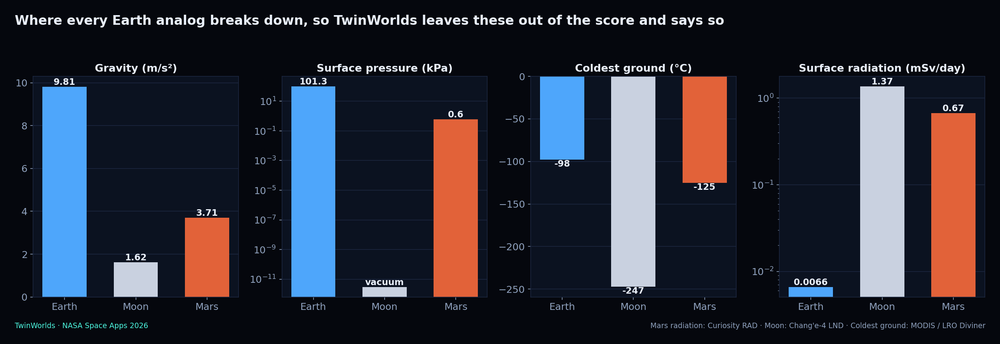

---

### Machine Learning Models (already deployed)

- **M1 · Analogue Space (unsupervised):** PCA followed by weighted k-means (k = 8) on all 354,342 land cells. It groups Earth's land into 8 environment types and places the 16 Moon and Mars targets among them. Cluster stability is **ARI 0.86**, and PC1 + PC2 explain **77 %** of the variance.
- **M2 · Learned weights (supervised):** non-negative logistic regression trained on **23 NASA analog pairs** to learn how much each dimension matters. It agrees with our design: **bare ground matters most, then frozen ground and relief.**
- **An honest result:** the learned weights reach 17 % recall in Earth's top 5 % versus 22 % for our hand-set weights, so **the hand-set weights stay the default**. A switch in the Finder lets anyone compare the two, and the `/models` page publishes both model cards.

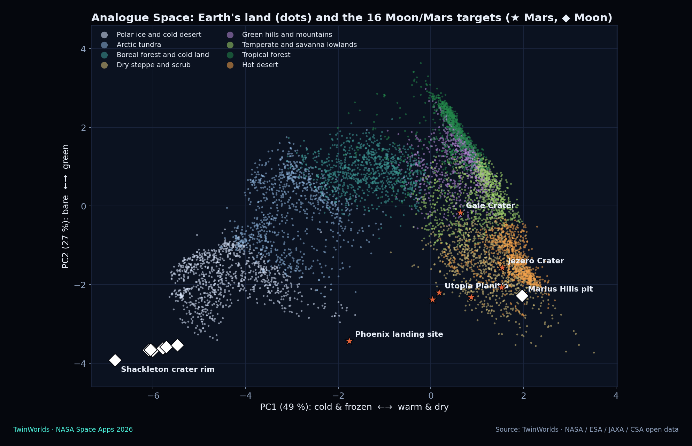
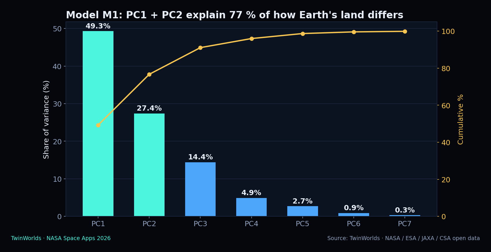
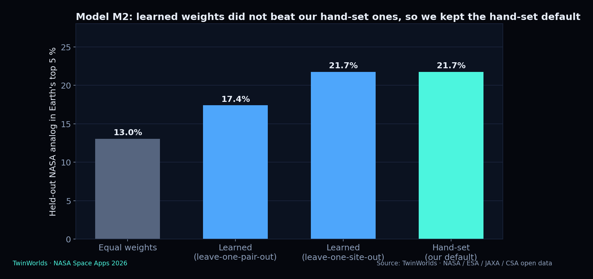
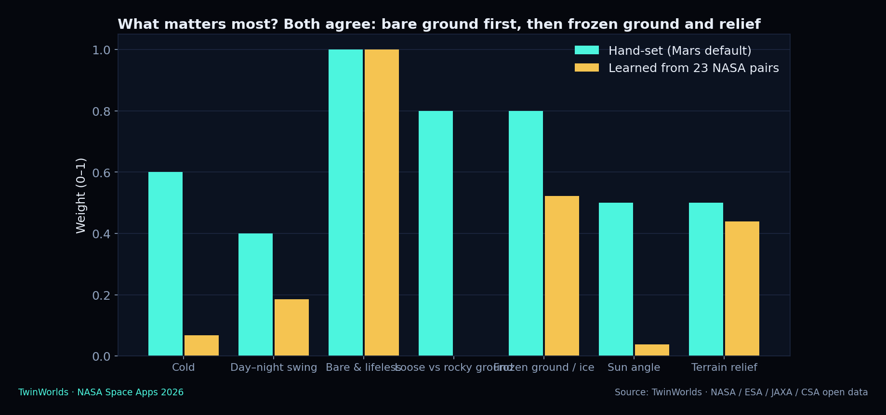
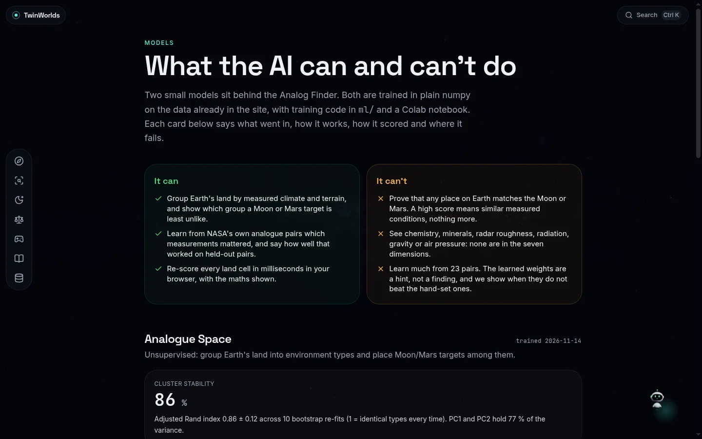

---

### Strategic Roadmap for Future Expansion

- **Mineralogy layer:** add ASTER and EMIT spectral data so the score covers **chemistry** (clays, sulfates, perchlorate-like salts) as well as climate and terrain.
- **Finer scale:** move from ~28 km cells to 1 km for **crater-, valley- and lava-tube-scale** matches.
- **Subsurface and caves:** add lava-tube and cave inventories to strengthen analogs for the Marius Hills pit and future Moon-base shelters.
- **Processes over time:** add dust-storm, seasonal ice and erosion time series, so TwinWorlds can match **processes** as well as places.
- **Open API:** let field teams and researchers run the Finder for their own targets and weights.

### Recommendations & Vision – Science-Driven Solutions

- **Data-driven analog selection:** we recommend that analog campaigns report a measured similarity profile alongside each site, as TwinWorlds does.
- **Pick the right analog for each test:** use thermal analogs for thermal tests and terrain analogs for mobility tests, because no single site matches everything.
- **Widen the map:** fund field validation at the highest-ranked but least-studied sites, such as the Skeleton Coast, the Karakoram and Dasht-e Kavir.
- **Be explicit about the limits:** every analog report should state what Earth cannot reproduce: gravity, vacuum, radiation and chemistry.

### Exploration & Global Impact

- **Artemis-ready:** the Bases page works directly with the 9 Artemis III candidate regions and LRO data.
- **Open science:** all 33 datasets are catalogued in the Data Lab with licence, resolution, credit and caveats.
- **Education:** five missions built on real data and physics (*Earth or Elsewhere?*, *Moon Base Scout*, *Touchdown*, *Sample Run*, *Launch Window*), plus a Learn page with a glossary.
- **Inclusion:** a Pakistan spotlight and Global South analogs, plus Urdu-ready right-to-left UI components.

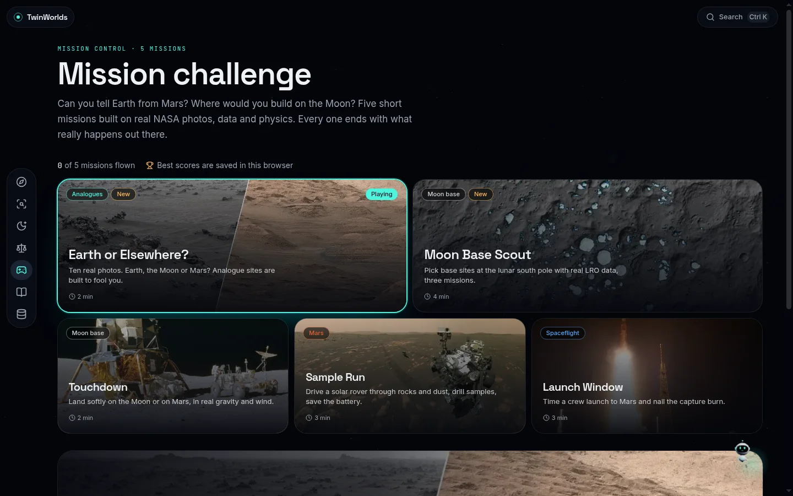
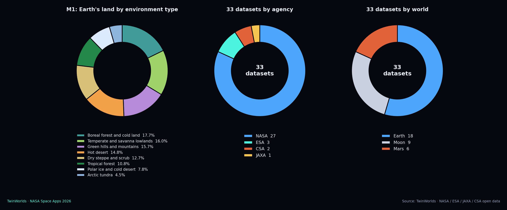

---

## Use of Artificial Intelligence (AI)

- **Rovi, the AI mission guide:** powered by **Claude Sonnet 4.6 on Amazon Bedrock**. It uses tools: it runs the Finder, samples the Moon map, flies the globe and highlights the panel it is talking about. It may only quote numbers that its data tools returned.
- **Machine learning:** two models trained in NumPy on our own processed NASA data (described above).
- **Development:** AI coding assistants helped write code and draft this text. All data, scores and charts come from the agency datasets listed below. All charts on this page were generated from our own data by our code. No AI-generated images are presented as real data.

## NASA Data

**Earth**
- **NASA Earthdata Search** – https://search.earthdata.nasa.gov/ – MODIS MOD11C3 land-surface temperature, MOD13C2 NDVI and MCD43C3 albedo (LP DAAC), which feed the Finder's Earth grid, plus a live CMR granule search in the Data Lab.
- **NASA Worldview** – https://worldview.earthdata.nasa.gov/ – GIBS tiles for the live Earth map, plus true-colour, temperature and NDVI snapshots of 17 analog sites.

**Moon and Mars**
- **NASA Planetary Data System (PDS)** – https://pds.nasa.gov/ (Geosciences Node: https://pds-geosciences.wustl.edu/) – LOLA, Diviner, Mini-RF and LEND for the Moon; Mars Odyssey GRS/NS, MGS TES thermal inertia and MGS MOLA for Mars. These are the Finder targets and the Bases layers.
- **NASA Lunar Reconnaissance Orbiter (LRO)** – https://science.nasa.gov/mission/lro/ – LOLA elevation and slope, Diviner temperatures, Mini-RF radar, LEND hydrogen and LROC mosaics, used on the Bases page, Explore and Radar Twins.
- **NASA LRO Diviner Lunar Data** – https://pds-geosciences.wustl.edu/lro/urn-nasa-pds-lro_diviner_derived1/data_derived_prp/ – the Polar Resource Product (ice stability depth), max/mean temperature and rock abundance, used for the cold-trap and ice layers and the Moon targets.

**Also used:** NASA POWER, NASA Moon Trek and Mars Trek, NASA SVS CGI Moon Kit, NASA Image and Video Library, NASA 3D Resources.

## Space Agency Partner & Other Data

**CSA (Canadian Space Agency)**
- **RADARSAT Constellation Mission (RCM) – Data** – https://donnees-data.asc-csa.gc.ca/en/dataset/rcm – 3 sample scenes processed into **Radar Twins**, shown beside LRO Mini-RF lunar radar.
- **RADARSAT-1 – Data** – https://donnees-data.asc-csa.gc.ca/dataset/bf51ec12-d6ff-43ab-a4f1-eb74ec9c8d73 – catalogued in the Data Lab with the Arctic analog scenes it would add. Downloading needs a free account, which we could not get in time.
- **Synthetic Aperture Radar (SAR) Python Tutorial** – https://github.com/asc-csa/Synthetic_Aperture_Radar_Tutorial – our Radar Twins script follows its read → inspect → geolocate → plot steps.

**ESA (European Space Agency)**
- **Copernicus Data Space Ecosystem** – https://dataspace.copernicus.eu/ – Sentinel-1 radar over 17 sites and Sentinel-2 L2A optical over 16 sites, used for the Data Lab and site cards.
- **ESA Open Science Catalog** – https://opensciencedata.esa.int/ – searched, with matching products listed in the Data Lab.

**JAXA (Japan Aerospace Exploration Agency)**
- **JAXA G-Portal** – https://gportal.jaxa.jp/gpr/ – JAXA's Earth-observation portal. We used the ALOS AW3D30 v3.2 elevation through the JAXA Earth API for the Finder's terrain-relief dimension.

**Other:** USGS Gazetteer of Planetary Nomenclature, Natural Earth (country outlines), SoilGrids (soil context in the Finder).

## References

**Challenge resources**
- NASA Earthdata Search – https://search.earthdata.nasa.gov/
- NASA Worldview – https://worldview.earthdata.nasa.gov/
- NASA Planetary Data System (PDS) – https://pds.nasa.gov/
- NASA Lunar Reconnaissance Orbiter (LRO) – https://science.nasa.gov/mission/lro/
- NASA LRO Diviner Lunar Data – https://pds-geosciences.wustl.edu/lro/urn-nasa-pds-lro_diviner_derived1/data_derived_prp/
- CSA RADARSAT Constellation Mission (RCM) – https://donnees-data.asc-csa.gc.ca/en/dataset/rcm
- CSA RADARSAT-1 – https://donnees-data.asc-csa.gc.ca/dataset/bf51ec12-d6ff-43ab-a4f1-eb74ec9c8d73
- CSA SAR Python Tutorial – https://github.com/asc-csa/Synthetic_Aperture_Radar_Tutorial
- ESA Copernicus Data Space Ecosystem – https://dataspace.copernicus.eu/
- ESA Open Science Catalog – https://opensciencedata.esa.int/
- JAXA G-Portal – https://gportal.jaxa.jp/gpr/

**Other sources**
- NASA PDS Geosciences Node – https://pds-geosciences.wustl.edu/
- NASA POWER – https://power.larc.nasa.gov/
- NASA Trek – https://trek.nasa.gov/
- NASA Analog Explorer – https://science.nasa.gov/solar-system/analog-explorer/
- NASA Astrobiology research locations – https://astrobiology.nasa.gov/research-locations/
- Putzig & Mellon (2007), *Apparent thermal inertia and the surface heterogeneity of Mars*, Icarus 191
- Tools: Next.js 16, React 19, TypeScript, Tailwind CSS v4, three.js, Leaflet, Python (NumPy, Matplotlib), Amazon Bedrock, Vercel
